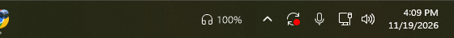

# BatteryBar

**Your wireless mouse, keyboard and headset battery, right on the Windows taskbar.**



No more surprise "mouse died mid-game". BatteryBar sits just left of your tray icons and shows a small icon and percentage for each wireless device. It's free, open source, and a 64 KB app with nothing else to install.

## Download

Grab **`BatteryBar-Setup-x.y.z.exe`** from the [Releases](../../releases) page and run it. No admin rights are needed. Windows 10 or 11 is required.

> Because the installer isn't code-signed yet, Windows SmartScreen may say "Windows protected your PC". Click **More info → Run anyway**.

## Features

- Shows battery % for each device, mice first, then keyboards, headsets and controllers
- A green ⚡ while charging, red at 15% or lower
- Sleeping devices keep showing their last reading, dimmed
- Hides automatically during fullscreen games and videos
- Follows Windows light and dark mode, and works with high-DPI displays and auto-hidden taskbars
- **Drag** to reposition, **hover** for device names, **right-click** for options (Refresh, Start with Windows, Reset position, Exit)

## Supported devices

| Works with | How |
|---|---|
| **Logitech** mice, keyboards and headsets on LIGHTSPEED, Unifying or Bolt receivers, plus wired and Bluetooth Logitech devices | Logitech HID++ 2.0 |
| **HyperX Cloud Stinger Core Wireless** (Kingston 0951:170B, 0951:1713 PS, HP 03F0:0A93) | HyperX feature-report protocol |
| **Any Bluetooth device** that Windows shows a battery for under *Settings → Bluetooth & devices* (Xbox controllers, earbuds, mice, keyboards…) | Windows battery property |
| USB dongles that use the standard HID "Battery Strength" report | HID usage 0x06/0x20 |

Most other brands' 2.4 GHz dongles (Razer, Corsair, SteelSeries, and so on) use their own protocol and aren't supported yet. If your device is missing, open an issue and attach the output of:

```
"%LOCALAPPDATA%\Programs\BatteryBar\BatteryBar.exe" --dump
```

That command writes `battery-dump.txt` next to the exe, listing your devices' HID interfaces and what BatteryBar could read.

## Building from source

Requirements: the [.NET SDK](https://dotnet.microsoft.com/download) (any recent version) and, for the installer, [Inno Setup 6](https://jrsoftware.org/isinfo.php).

```
dotnet build BatteryBar -c Release
"%LOCALAPPDATA%\Programs\Inno Setup 6\ISCC.exe" installer\BatteryBar.iss
```

The app is built in `BatteryBar\bin\Release\net48\` and the installer in `dist\`. The app targets .NET Framework 4.8, which ships with Windows 10 and 11, so users don't need to install a runtime.

| File | What it does |
|---|---|
| `BatteryBar/Batteries.cs` | Reads devices: Logitech HID++, HyperX, Windows Bluetooth, generic HID |
| `BatteryBar/OverlayForm.cs` | The taskbar overlay: drawing, placement, menu, settings |
| `BatteryBar/Native.cs` | Win32, SetupAPI and HID declarations |
| `installer/BatteryBar.iss` | Inno Setup installer script |

Useful flags: `--dump` writes a diagnostic report, and `--demo` shows fake devices for screenshots.

## Privacy

BatteryBar makes no network connections and collects nothing. It reads battery data from your own USB and Bluetooth devices, and saves only its position and last readings on your PC.

## License

MIT. See [LICENSE](LICENSE). The HyperX protocol details come from [HyperBatteryMonitor](https://github.com/davidsantanaalves/HyperBatteryMonitor) (MIT); see [THIRD-PARTY-NOTICES.txt](THIRD-PARTY-NOTICES.txt).

Logitech, HyperX, Xbox and other product names are trademarks of their respective owners. BatteryBar is not affiliated with or endorsed by them.
